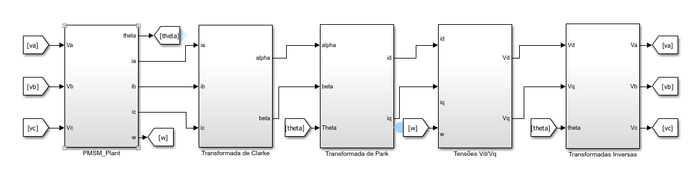
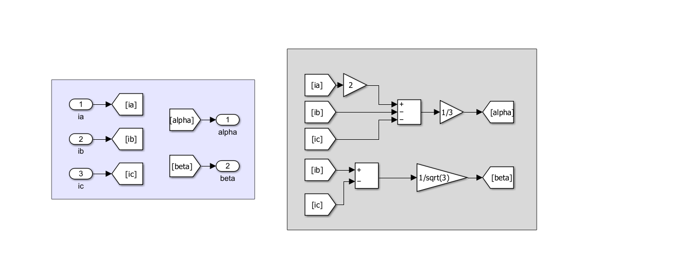
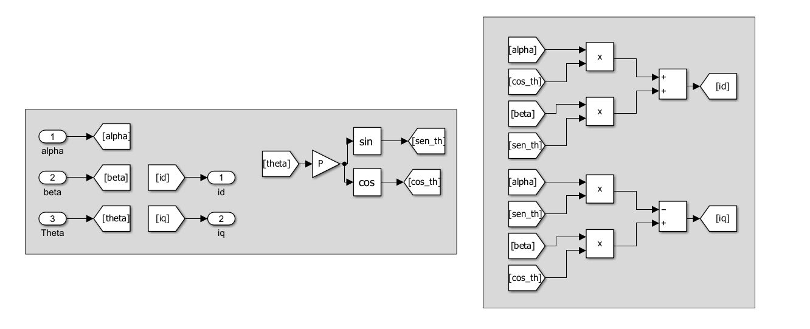
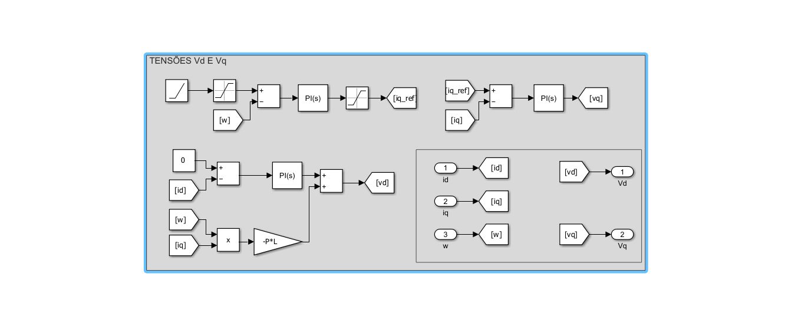
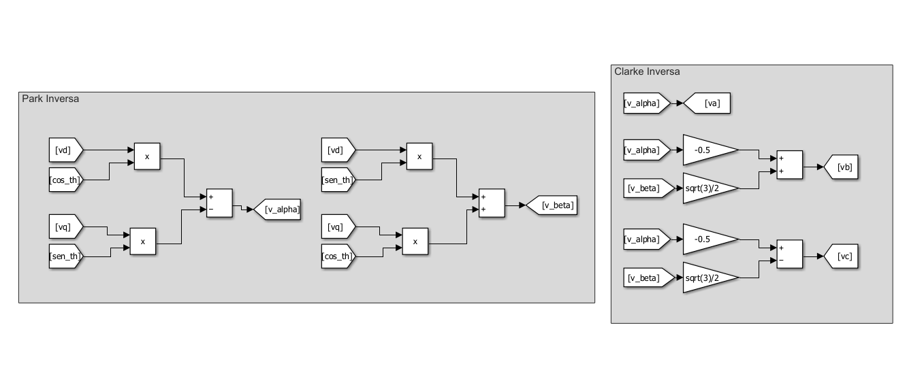
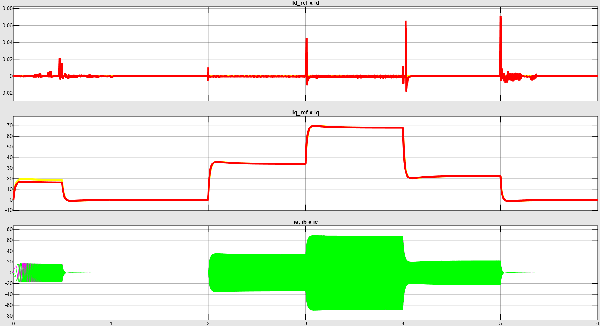

# Ep. 03 — Field-Oriented Control (FOC): Malhas Internas de Corrente ($dq$)

Implementação analítica e em malha fechada do algoritmo de Controlo por Orientação de Campo (FOC) para o desacoplamento dinâmico e regulação em corrente de um Motor Síncrono de Ímanes Permanentes (PMSM) de polos lisos ($L_d \approx L_q = L$), baseado no motor EMRAX 208 HV LC.

---

## 1. Arquitetura do Sistema no Simulink

O sistema de controlo vetorial atua no referencial síncrono girante ($dq$), permitindo a regulação independente do fluxo magnético e do binário eletromagnético:

A cadeia de controlo organiza-se nos seguintes subsistemas modulares:
1. **PMSM_Plant:** Modelo físico da máquina desacoplado em três domínios (Cálculo das Correntes, Mecânica e FCEM) desenvolvido no Ep. 02.
2. **Transformada de Clarke:** Converte as correntes de fase reais ($i_a, i_b, i_c$) para o referencial ortogonal estacionário bifásico ($i_\alpha, i_\beta$).
3. **Transformada de Park:** Sincroniza o vetor de corrente com a rotação do fluxo do rotor através da posição elétrica ($\theta_e = P \cdot \theta$), projetando as correntes contínuas ($i_d, i_q$).
4. **Tensões Vd/Vq:** Controladores PI independentes responsáveis pela regulação em malha fechada dos erros de corrente e pela síntese das tensões de comando ($v_d^*, v_q^*$).
5. **Transformadas Inversas:** Converte o vetor de tensão do referencial síncrono ($v_d^*, v_q^*$) de volta ao plano estacionário ($v_\alpha^*, v_\beta^*$) e sintetiza as tensões trifásicas de comando ($v_a^*, v_b^*, v_c^*$) injetadas nos enrolamentos da máquina.

---

## 2. Subsistemas Internos e Formulação Matemática

### 2.1. Transformada de Clarke
Converte o sistema trifásico dependente no tempo num sistema ortogonal bifásico estacionário fixo no estator:

$$\begin{bmatrix} i_\alpha \\ i_\beta \end{bmatrix} = \frac{2}{3} \begin{bmatrix} 1 & -\frac{1}{2} & -\frac{1}{2} \\ 0 & \frac{\sqrt{3}}{2} & -\frac{\sqrt{3}}{2} \end{bmatrix} \begin{bmatrix} i_a \\ i_b \\ i_c \end{bmatrix}$$

---

### 2.2. Transformada de Park
Alinha as grandezas com o vetor do fluxo magnético gerado pelos ímanes do rotor utilizando o ângulo elétrico ($\theta_e = P \cdot \theta$):

$$\begin{bmatrix} i_d \\ i_q \end{bmatrix} = \begin{bmatrix} \cos(\theta_e) & \sin(\theta_e) \\ -\sin(\theta_e) & \cos(\theta_e) \end{bmatrix} \begin{bmatrix} i_\alpha \\ i_\beta \end{bmatrix}$$

---

### 2.3. Controladores de Corrente (`Tensões Vd/Vq`)
A dinâmica elétrica de fase no domínio de Laplace é dada por:

$$G_e(s) = \frac{1}{L s + R_s} = \frac{1 / R_s}{\frac{L}{R_s} s + 1}$$

Adotando um compensador PI na forma $C_i(s) = K_{p\_i} + \frac{K_{i\_i}}{s}$ e aplicando o **Método do Cancelamento de Polo-Zero**:

$$\frac{K_{i\_i}}{K_{p\_i}} = \frac{R_s}{L}$$

Para uma largura de banda de corrente especificada $\omega_{bw\_i} = 2\pi f_{bw\_i}$ ($\text{rad/s}$):

$$K_{p\_i} = L \cdot \omega_{bw\_i}$$
$$K_{i\_i} = R_s \cdot \omega_{bw\_i}$$

---

### 2.4. Transformadas Inversas
Reversão do referencial síncrono para aplicação física das tensões terminais no estator:

$$\begin{bmatrix} v_\alpha^* \\ v_\beta^* \end{bmatrix} = \begin{bmatrix} \cos(\theta_e) & -\sin(\theta_e) \\ \sin(\theta_e) & \cos(\theta_e) \end{bmatrix} \begin{bmatrix} v_d^* \\ v_q^* \end{bmatrix}$$

$$\begin{bmatrix} v_a^* \\ v_b^* \\ v_c^* \end{bmatrix} = \begin{bmatrix} 1 & 0 \\ -\frac{1}{2} & \frac{\sqrt{3}}{2} \\ -\frac{1}{2} & -\frac{\sqrt{3}}{2} \end{bmatrix} \begin{bmatrix} v_\alpha^* \\ v_\beta^* \end{bmatrix}$$

---

## 3. Parâmetros de Projeto e Ganhos (`setup_foc_current.m`)

| Parâmetro / Variável | Símbolo | Valor | Unidade |
| :--- | :---: | :---: | :---: |
| Frequência de Corte da Malha | $f_{bw\_i}$ | 300 | $\text{Hz}$ |
| Largura de Banda Angular | $\omega_{bw\_i}$ | $\approx 1885$ | $\text{rad/s}$ |
| Ganho Proporcional de Corrente | `Kp_i` | 0.4241 | $\text{V/A}$ |
| Ganho Integral de Corrente | `Ki_i` | 48.406 | $\text{V/(A}\cdot\text{s)}$ |
| Referência de Fluxo Direto | $i_d^*$ | 0 | $\text{A}$ |

---

## 4. Resultados e Validação Dinâmica

Ensaio dinâmico com degraus em patamares na corrente de quadratura ($i_q^*$) sob imposição estrita de $i_d^* = 0\text{ A}$:

* **Eixo Direto (`Id_ref x Id`):** Regulação estrita em $0\text{ A}$. Transitórios rápidos de comutação decorrentes da derivada da corrente de quadratura ($\frac{di_q}{dt}$) permanecem com picos inferiores a $0{,}08\text{ A}$ e são prontamente rejeitados pela ação integral.
* **Eixo de Quadratura (`Iq_ref x Iq`):** Seguimento ágil e estável nos patamares de $0\text{ A}$, $35\text{ A}$, $70\text{ A}$ e $20\text{ A}$, sem sobressinais expressivos e com tempo de acomodação coincidente com o dimensionamento analítico.
* **Correntes Reais de Fase (`ia, ib e ic`):** Sinusoides equilibradas e simétricas desfasadas de $120^\circ$, cuja amplitude escala proporcionalmente a $i_q^*$ e cujas amplitudes convergem para zero durante as janelas de repouso ($i_q^* = 0\text{ A}$).

---

## 5. Como Executar
1. Navegue até à pasta `Ep03_FOC_Current/` no MATLAB.
2. Execute o script `setup_foc_current.m` para calcular os ganhos e carregar as variáveis no Workspace.
3. Abra o ficheiro `foc_current_loops.slx` no Simulink e inicie a simulação.
