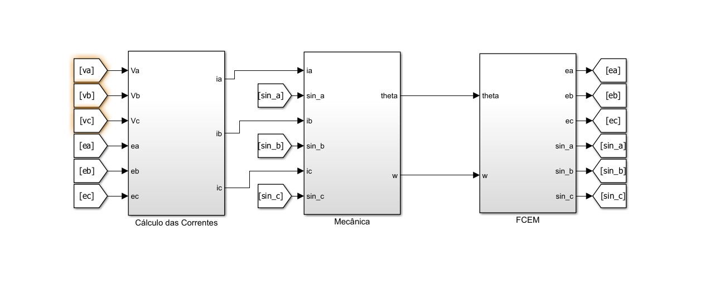
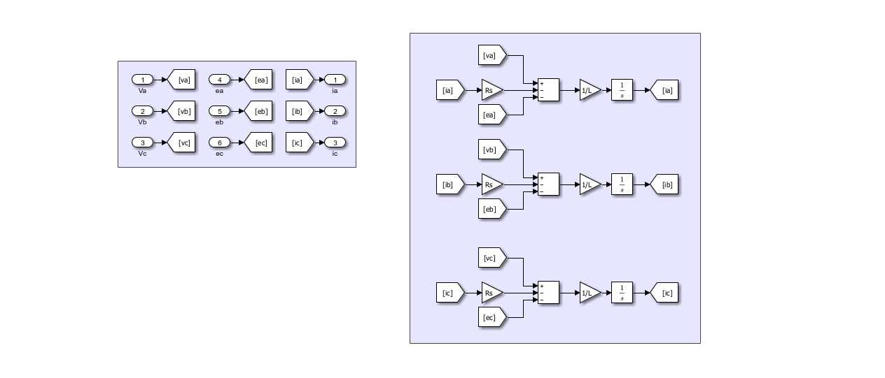
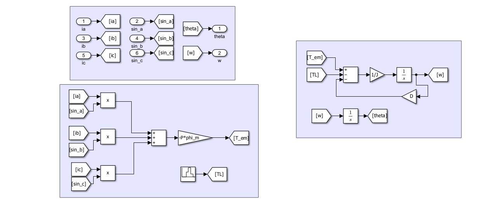
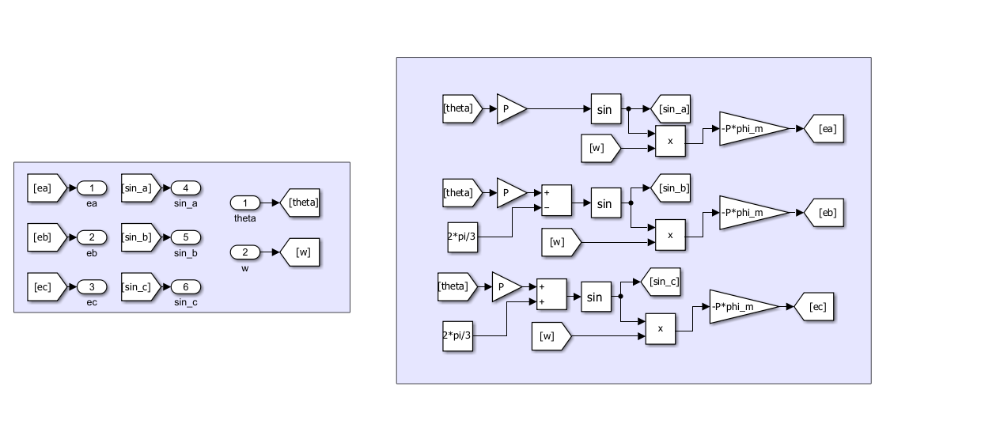
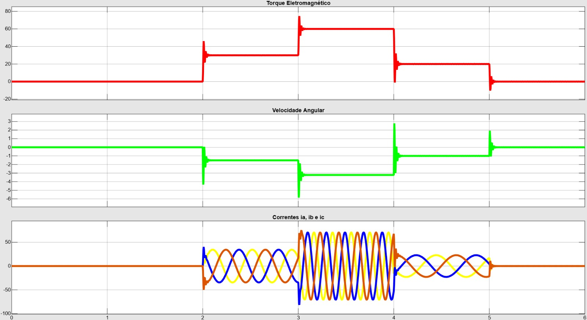

# Ep. 02 — Modelagem Dinâmica da Máquina PMSM no Referencial Trifásico ($abc$)

Implementação analítica e simulação em malha aberta de um Motor Síncrono de Ímãs Permanentes (PMSM) com polos lisos ($L_d \approx L_q = L$), considerando a dinâmica elétrica de estator, a indução da Força Contraeletromotriz (FCEM) e o equilíbrio mecânico do trem de força.

---

## 1. Arquitetura do Modelo no Simulink

Para evitar laços algébricos (*algebraic loops*) causados pela interdependência mútua entre corrente, velocidade e tensão induzida, a planta foi dividida em três subsistemas desacoplados com tags locais:

1. **Cálculo das Correntes:** Integra as equações diferenciais de fase a partir das tensões terminais, da impedância estatórica e da FCEM.
2. **Dinâmica Mecânica:** Computa o torque eletromagnético instantâneo ($T_{em}$), soma o torque de carga da pista ($T_L$) e integra a aceleração angular.
3. **Força Contraeletromotriz (FCEM):** Gera as tensões induzidas defasadas em $120^\circ$ e os termos senoidais de posição a partir da velocidade $\omega$ e ângulo $\theta$.

---

## 2. Subsistemas e Formulação Matemática

### 2.1. Dinâmica Elétrica de Fase (`Cálculo das Correntes`)
A lei das malhas de estator para cada fase da máquina:

$$\frac{di_a}{dt} = \frac{1}{L} \left( v_a - R_s i_a - e_a \right)$$
$$\frac{di_b}{dt} = \frac{1}{L} \left( v_b - R_s i_b - e_b \right)$$
$$\frac{di_c}{dt} = \frac{1}{L} \left( v_c - R_s i_c - e_c \right)$$

---

### 2.2. Equilíbrio Mecânico e Cálculo de Torque (`Mecânica`)
O torque eletromagnético resultante da interação das correntes de estator com o fluxo do rotor:

$$T_{em} = -P \cdot \phi_m \left[ i_a \sin(\theta_e) + i_b \sin\left(\theta_e - \frac{2\pi}{3}\right) + i_c \sin\left(\theta_e + \frac{2\pi}{3}\right) \right]$$

A equação do movimento do conjunto mecânico (inércia do rotor e trem de força):

$$J \frac{d\omega}{dt} = T_{em} - T_L - D\omega$$
$$\frac{d\theta}{dt} = \omega$$

---

### 2.3. Força Contraeletromotriz (`FCEM`)
Tensões induzidas calculadas em função da velocidade mecânica $\omega$ e da posição elétrica $\theta_e = P \cdot \theta$:

$$e_a = -P \cdot \phi_m \cdot \omega \cdot \sin(\theta_e)$$
$$e_b = -P \cdot \phi_m \cdot \omega \cdot \sin\left(\theta_e - \frac{2\pi}{3}\right)$$
$$e_c = -P \cdot \phi_m \cdot \omega \cdot \sin\left(\theta_e + \frac{2\pi}{3}\right)$$

---

## 3. Parâmetros da Máquina (Base: EMRAX 208 HV LC)

Parâmetros configurados no script `setup_motor.m`:

| Parâmetro | Variável | Valor | Unidade |
| :--- | :---: | :---: | :---: |
| Pares de Polos | `P` | 10 | — |
| Resistência de Fase | `Rs` | 25.68 | $\text{m}\Omega$ |
| Indutância do Eixo d | `Ld` | 220 | $\mu\text{H}$ |
| Indutância do Eixo q | `Lq` | 230 | $\mu\text{H}$ |
| Indutância Média Equivalente | `L` | 225 | $\mu\text{H}$ |
| Fluxo dos Ímãs Permanentes | `phi_m` | 0.05867 | $\text{Wb}$ |
| Momento de Inércia do Rotor | `J` | 0.0239 | $\text{kg}\cdot\text{m}^2$ |
| Coeficiente de Atrito Viscoso | `D` | $5 \times 10^{-5}$ | $\text{N}\cdot\text{m}\cdot\text{s/rad}$ |

---

## 4. Resultados e Validação Dinâmica

Ensaio transitório em malha aberta com degraus de corrente e resposta mecânica da planta:

* **Comportamento das Correntes ($i_a, i_b, i_c$):** As correntes de fase mantêm a defasagem simétrica de $120^\circ$, com frequência elétrica estritamente vinculada à rotação mecânica da máquina ($\omega_e = P \cdot \omega$).
* **Operação em Circuito Aberto ($v_{abc} = 0$):** Sem as tensões chaveadas de um inversor nas entradas $[v_a, v_b, v_c]$, a única tensão atuando no circuito é a própria contraeletromotriz ($-e_{abc}$). O sistema opera em regime puramente regenerativo/frenagem dinâmica, demonstrando que o motor não mantém rotação estável sem sincronismo de campo.
* **Necessidade de Malha Fechada:** Para impor aceleração positiva e controle de torque desacoplado, é necessária a sincronização do vetor de tensão via **Field-Oriented Control (FOC)**, implementado no Episódio 03.

---

## 5. Como Executar
1. Abra o MATLAB e navegue até esta pasta.
2. Execute o script `setup_motor.m` para inicializar os parâmetros no Workspace.
3. Abra o modelo `pmsm_plant.slx` no Simulink e inicie a simulação.
